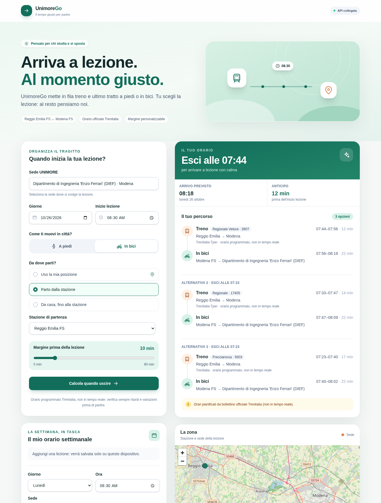

# UnimoreGo

[](https://github.com/Jaski99/unimore-go/actions/workflows/ci.yml)
[](LICENSE)

> 🇮🇹 [Italiano](#italiano) · 🇬🇧 [English](#english)



---

## Italiano

### Cos'è

**UnimoreGo** è una web app per studenti pendolari di **UNIMORE** che risponde a una domanda: *a che ora devo uscire di casa per arrivare a lezione?*
Scegli sede, giorno e ora della lezione, da dove parti e come ti muovi in città: l'app combina i treni **Modena FS ↔ Reggio Emilia FS** con il primo/ultimo tratto attivo e mostra **«Esci alle HH:MM»**, l'arrivo previsto, l'anticipo e fino a 3 alternative.

Opzioni (v0.5):

| Opzione | Default | Note |
|---|---|---|
| **Andata / Ritorno** | Andata | Andata: «a che ora esco?» (`arrive_by`, inizio lezione). Ritorno: «a che ora parto?» (`depart_after`, fine lezione → primo treno utile verso casa). |
| **Da dove parti** | Stazione | Stazione, oppure **casa** da indirizzo (ricerca OpenStreetMap/Nominatim), dalla tua posizione o da un tocco sulla mappa; minuti casa↔stazione facoltativi. |
| **A piedi / In bici** | In bici | Primo e ultimo tratto. |
| **Tempo in stazione** | 5 min | 1–30 min per biglietto e binario: «Esci alle» non coincide mai con la partenza del treno. |
| **Anticipo a lezione** | 10 min | 0–60 min (solo andata). |
| **Solo regionali (R/RV)** | attivo | Disattivandolo compaiono anche IC/FR con il badge **«Biglietto diverso / supplemento»**. |

Stazioni coperte: **Reggio Emilia FS, Rubiera, Modena FS** (la home lo dice sotto «Da dove parti», con il periodo di validità). Altre stazioni verranno aggiunte solo con orari verificabili ([`data/SOURCES.md`](data/SOURCES.md)).

Cosa fa la pagina (v0.6):

- **Nessun risultato non richiesto.** Il calcolo parte solo con **Calcola** oppure aprendo un link condiviso completo.
- **Cosa si ricorda.** Dopo il reload restano sede, stazione, modo e anticipo (`localStorage`, mai la data). Il giorno è sempre **oggi**, con il badge «Oggi» e il pulsante «Torna a oggi». L'orario settimanale può precompilare la lezione.
- **Orario calcolato spiegato, una volta sola:** il riquadro del calcolo compare solo quando c'è un risultato per quella data; senza treni la formula è dentro l'unico avviso, e fuori validità resta solo l'avviso con la soluzione del giorno vicino. Per esempio domenica 25/10, Modena FS → Palazzo Dossetti, lezione 09:00: «Calcolo: lezione alle 09:00 − 10 min di anticipo − 19 min a piedi dalla stazione alla sede = arrivo a Reggio Emilia FS entro le 08:31.»
- **Un solo avviso** per volta, con priorità chiara (fuori validità > nessun treno > nota di calendario > …), più la nota «Orari programmati, non in tempo reale».
- **Durata porta a porta e numero di cambi;** i pulsanti «?» spiegano anticipo e tempo in stazione.
- **Domenica/festivi senza treni utili:** propone lo stesso orario nel giorno feriale precedente/successivo, spiegato. Con un treno trovato aggiunge comunque «orario festivo, servizio ridotto: verifica su Trenitalia».
- **Primo treno dopo l'orario:** un solo testo coerente, per esempio «arrivi in sede 4 min prima dell'inizio della lezione, meno dei 10 min di anticipo che hai scelto» oppure «arrivi in sede 7 min in ritardo».
- **Date in italiano ovunque,** nel formato «lun 26 ott 2026» (Intl it-IT nel sito, stesso testo negli avvisi dell'API).
- **Ritardi e scioperi.** Riquadro con il numero del treno («Copia numero») e i link a ViaggiaTreno e all'infomobilità Trenitalia. ViaggiaTreno non documenta un formato di link per singolo treno, quindi il numero va incollato nella sua ricerca.
- **«Calcola il ritorno»** dal risultato dell'andata, con le stesse impostazioni: vista andata + ritorno. La fine lezione proposta (inizio + 2 ore) è dichiarata finché non la modifichi; «Tempo per uscire dall'aula» ha un aiuto che lo spiega.
- **Azioni:** «Aggiungi al calendario» (file `.ics` generato nel browser, promemoria 10 min prima di «Esci alle»), «Copia link» e «Condividi» (Web Share API, con la copia come alternativa).
- **Mappa sotto il risultato** con zoom automatico. Le etichette sono Casa / Stazione partenza / Stazione arrivo / Sede, sopra o sotto il marker per non sovrapporsi; la legenda mostra solo ciò che è sulla mappa. Il treno è una linea continua, i tratti a piedi/in bici sono tratteggiati. Dopo «Calcola il ritorno» la mappa disegna il ritorno, con un selettore Andata/Ritorno.
- **Sede:** il campo seleziona tutto il testo al focus e il nome completo della sede scelta resta leggibile sotto il campo.
- **Mobile 375×667 e 414×896:** pulsante Calcola fisso in basso mentre compili; dopo il calcolo, scroll al risultato e focus sul suo titolo. Risultato e mappa subito sotto il modulo, nessuno scroll orizzontale.

#### Link condivisibili (parametri URL)

Ogni ricerca finisce nella barra degli indirizzi: Indietro/Avanti/Ricarica rifanno lo stesso calcolo. Un link condiviso non sovrascrive le preferenze salvate di chi lo apre.

| Parametro | Valori | Esempio |
|---|---|---|
| `sede` | `dief`, `palazzo_dossetti`, `campus_san_lazzaro`, `economia_biagi`, `giurisprudenza` | `sede=dief` |
| `stazione` | `reggio_fs`, `rubiera`, `modena_fs` | `stazione=reggio_fs` |
| `partenza` | `casa` (al posto di `stazione`; l'indirizzo non va mai nel link, si usa quello salvato su questo dispositivo) | `partenza=casa` |
| `data` | `AAAA-MM-GG` | `data=2026-10-26` |
| `ora` | `HH:MM`, inizio lezione (andata) o fine lezione (ritorno) | `ora=08:30` |
| `mezzo` | `bici`, `piedi` | `mezzo=bici` |
| `verso` | `andata`, `ritorno` | `verso=andata` |
| `ritorno` | `HH:MM` fine lezione, per la vista andata + ritorno | `ritorno=13:00` |

Il link è completo con `sede` + `data` + `ora`; i parametri non validi vengono ignorati uno per uno. Esempio: `/?sede=dief&stazione=reggio_fs&data=2026-10-26&ora=08:30&mezzo=bici&verso=andata&ritorno=13:00`.

Regola di dominio: **mai il treno dentro la stessa città**. Casa (o stazione) e sede nella stessa città → solo piedi/bici.
Se non c'è un treno utile (notte, festivi, date fuori validità) l'app lo dice in italiano e propone la soluzione precedente/successiva.

Lo screenshot qui sopra mostra un risultato reale dell'API: Reggio Emilia FS → DIEF, lunedì 26/10/2026, lezione alle 08:30, bici, margine 10 min, 5 min in stazione, solo regionali. Esito: **esci alle 07:39**, 5 minuti in stazione, RV 3907 delle 07:44 → 07:56, bici fino al DIEF in 22 minuti, arrivo alle 08:18 con 12 minuti di anticipo. Alternative: 07:28 (R 17405) e 06:59 (RV 2451).

Revisione da pendolare, round 1 e 2 (mobile e desktop, Lighthouse mobile 93–95 / 100 / 100, axe 0 violazioni): [`docs/review-phase5.md`](docs/review-phase5.md). Novità: [`CHANGELOG.md`](CHANGELOG.md).

### Avvio rapido

Requisiti: Python ≥ 3.11, Node.js ≥ 20, npm, `make`.

**Memoria (verificato da un solo clone pulito, v0.6, A8):** su una macchina con 2 vCPU e 2 GB di RAM, `npm ci --prefer-offline` riesce in 14 s con un picco di 816 MB di memoria di sistema; `next build` arriva a 1340 MB. Servono quindi circa **1,5 GB di RAM libera** durante la build. Non clonare in una `/tmp` di tipo *tmpfs*: `node_modules` finirebbe in RAM (era la causa dell'exit 137 del round 2). Se la memoria non basta, ferma API e sito prima di `npm ci`/`next build`.

```bash
make install   # .venv + pip install -e ".[dev]"  e  npm ci in web/
make dev       # API su http://localhost:8000 + web su http://localhost:3000
```

Con Docker:

```bash
docker compose up --build   # api :8000, web :3000
```

> v0.5: `docker compose build` e `docker compose up` sono stati verificati (API *healthy*, `scripts/smoke.sh` superato contro il container, web 200, preflight CORS ok).

Avvio manuale dei due processi:

```bash
CORS_ORIGINS=http://localhost:3000 uvicorn api.main:app --port 8000
cd web && NEXT_PUBLIC_API_URL=http://localhost:8000 npm run dev
```

Documentazione OpenAPI: http://localhost:8000/docs

#### Variabili d'ambiente

| Variabile | Dove | Default | Significato |
|---|---|---|---|
| `CORS_ORIGINS` | API | `http://localhost:3000` | Origini ammesse, separate da virgola |
| `NEXT_PUBLIC_API_URL` | web (build) | `http://localhost:8000` | URL base dell'API usato dal browser; `/` = stessa origine (proxy) |
| `NEXT_PUBLIC_USE_MOCK` | web (build) | *(vuoto)* | `1` = usa il mock offline invece dell'API (fallback esplicito) |
| `API_PROXY_TARGET` | web (build/start) | *(vuoto)* | Se impostato, Next.js inoltra `/api/*` a questo URL (es. `http://127.0.0.1:8000`) |
| `API_PORT`, `WEB_PORT` | `scripts/dev.sh` | `8000`, `3000` | Porte di sviluppo |

Il mock (`NEXT_PUBLIC_USE_MOCK=1`) non contiene dati scritti a mano: `web/src/lib/api/mock-fixtures.json` è generato da `make fixtures` (`tools/export_mock_fixtures.py`) chiamando l'API reale e copre un solo caso, quello dello screenshot. Un test pytest fallisce se le fixture non corrispondono più all'API.

#### Test e qualità

```bash
make test    # pytest (copertura ≥ 90%) + vitest
make lint    # ruff, validazione dataset, eslint, tsc
make build   # build di produzione Next.js
make smoke   # curl end-to-end su un'API in esecuzione
python scripts/e2e_ui.py http://localhost:3000   # browser reale (Playwright): 8 casi UI == API, 5 flussi (URL/cronologia, ritorno e mappa del ritorno, .ics, mappa e legenda, combobox, testi del round 3), mobile 375×667 e 414×896 (pulsante fisso, focus sul risultato), axe-core
# opzioni: --only cases|flows|mobile|axe, --screenshot PERCORSO
```

La CI GitHub Actions (`.github/workflows/ci.yml`) ha due job: **Python** (ruff + validazione dati + pytest, Python 3.11–3.13) e **Web** (eslint + prettier + tsc, vitest, `next build`).

### Architettura

```
 Browser ──HTTP/JSON──▶ api/ (FastAPI) ──▶ engine/ (dominio) ──▶ repositories ──▶ data/*.json
   ▲                      │                                     (interfacce astratte)
 web/ (Next.js)           └─ settings (env), errors, schemas Pydantic, routers
```

Le dipendenze vanno in una sola direzione: `web → (HTTP) → api → engine`. `engine` non conosce FastAPI né il frontend.

| Modulo | Responsabilità |
|---|---|
| `engine/models.py` | Dataclass immutabili: `Station`, `Campus`, `TrainRun`, `Leg` (walk/bike/train/wait, note), `Itinerary`, `PlanRequest`, `PlanResult` |
| `engine/repositories.py` | Interfacce `TrainRepository`, `LocationRepository`, `SegmentRepository` + implementazioni JSON |
| `engine/legs.py` | Strategie dei tratti: `WalkLegPlanner`, `BikeLegPlanner` (`ActiveLegPlanner`), `TrainLegPlanner` |
| `engine/planner.py`, `engine/journeys/` | Facciata `Planner.plan(request, name)`; planner registrati per nome: `arrive_by` (andata) e `depart_after` (ritorno), max 3 itinerari + soluzioni vicine |
| `engine/origin.py`, `engine/itinerary_builder.py` | `OriginResolver` (stazione/casa, stessa città) e `ItineraryBuilder` (tratto `wait` in stazione, nessun tratto da 0 min) |
| `engine/calendar_rules.py`, `engine/service_calendar.py`, `engine/holidays.py` | Note di calendario del PDF → regole componibili; festività nazionali; corsa effettuata in una data? |
| `engine/train_categories.py`, `engine/validity.py` | Gruppi R/RV · IC/ICN · FR e biglietto diverso; finestra di validità dell'orario dai dati |
| `api/settings.py` | Configurazione da env (`CORS_ORIGINS`), iniettabile in `create_app(settings)` |
| `api/deps.py` | Dependency injection di repository e planner (sostituibili nei test) |
| `api/routers/*` | `GET /api/health`, `GET /api/campuses`, `GET /api/stations`, `POST /api/plan`, `GET /api/geocode` |
| `api/geocoding.py` | `NominatimGeocoder`: ricerca indirizzi limitata a MO/RE, 1 richiesta/s, cache LRU |
| `api/schemas.py`, `api/errors.py` | Contratto Pydantic v2 ed errori uniformi `{detail, code}` |
| `web/src/lib/api/` | Porta `PlanService`; `HttpPlanService` (fetch), `MockPlanService` (fixture), `config`, tipi TS del contratto, proxy opzionale |
| `web/src/lib/plan-request.ts` | Valori del form (default: oggi) → corpo di `POST /api/plan`, validazione |
| `web/src/lib/preferences-store.ts`, `lesson-prefill.ts` | Preferenze in `localStorage`; lezione di oggi dall'orario settimanale |
| `web/src/lib/itinerary-summary.ts`, `route-geometry.ts` | Testi del risultato (treno, attesa, biglietto) e geometria del percorso sulla mappa |
| `web/src/hooks/use-planner-values.ts` | Stato del form: ripristino, precompilazione, salvataggio |
| `web/src/hooks/use-plan.ts` | Stato idle/caricamento/esito/vuoto/errore, indipendente dalla UI |
| `web/src/components/` | Form controllato, ricerca sede, casa (indirizzo/mappa), risultato, timeline, soluzioni vicine, orario settimanale, mappa Leaflet (caricata solo quando serve) |
| `tools/` | `validate_data.py` (coerenza dataset), `export_mock_fixtures.py` |

**Estendibilità.**
- **Nuova modalità attiva** (es. monopattino): basta una sottoclasse di `ActiveLegPlanner`, registrata con `Planner(..., active_planners={"scooter": ...})`, senza modificare il planner. L'API accetta oggi solo `walk|bike`.
- **Nuova domanda** (es. «arrivo entro…» con cambi): basta un nuovo `JourneyPlanner` registrato per nome, che riusa le stesse strategie dei tratti.
- **Nuovi tipi di nota di calendario:** basta aggiungere un `ClauseParser` al registro di `CalendarNoteParser`.
- **Nuovi orari o corse:** si aggiornano i dati dietro `TrainRepository`.
- **Nuove fonti** (es. GTFS): basta una nuova implementazione del repository.
- **Nuovi backend lato web:** basta una nuova implementazione di `PlanService`.

### Limiti dei dati

- **Non è in tempo reale.** Gli orari sono uno snapshot manuale del PDF ufficiale Trenitalia *Regionale Emilia*, edizione valida dal **17/10/2026 al 12/12/2026**: [Regionale_Emilia.pdf](https://www.trenitalia.com/content/dam/trenitalia/allegati/info/orario-digitale/orari-regionali/Regionale_Emilia.pdf). Il PDF è stato verificato il 23/10/2026; il metodo è descritto in `docs/research/STATUS_treni.md`. Ritardi, soppressioni, scioperi e lavori non sono considerati. Fuori dal periodo di validità l'API aggiunge un avviso.
- `data/trains.json` contiene 402 corse estratte dal PDF Trenitalia (17/10–12/12/2026) tra Reggio Emilia FS, Rubiera e Modena FS, su tutti i giorni della settimana con le note di calendario del PDF: Regionale, Regionale Veloce, Intercity, Intercity Notte, EuroCity e Frecciarossa. Le ultime quattro categorie richiedono titoli di viaggio diversi dal regionale. Fonti e metodo: [`data/SOURCES.md`](data/SOURCES.md).
- Il motore filtra per `valid_from`/`valid_to`, per le note di calendario e per le **festività nazionali** (es. 1/11, 8/12).
- **Domeniche e festivi (v0.6).** Il PDF indica i giorni di circolazione con simboli stampati accanto all'orario (legenda a pag. 6 del file): ⚒ lavorativi, † festivi, Ⓐ lavorativi escluso il sabato, Ⓑ tutti i giorni escluso il sabato, Ⓒ sabato e festivi. Fino alla v0.5 l'estrattore li ignorava e ogni corsa valeva tutti i giorni: una domenica dava lo stesso risultato di un lunedì. Ora **30 corse su 402** hanno un simbolo di giorno (19 ⚒, 6 †, 3 Ⓑ, 1 Ⓐ, 1 Ⓒ); le altre **372 non hanno simbolo**, quindi secondo il PDF circolano tutti i giorni, salvo le loro note di calendario. Esempio: alle 12:44 Reggio Emilia → Modena circola R 3921 nei giorni lavorativi e R 3953 nei festivi (pag. 92). Treni R/RV da Reggio Emilia a Modena: 39 lun 26/10, 38 dom 25/10, 36 mar 8/12. Di domenica e nei festivi la risposta aggiunge sempre, anche quando c'è un treno, l'avviso «orario festivo, servizio ridotto: verifica su Trenitalia».
- **Note di calendario.** `calendar_rules` interpreta le note del PDF con una grammatica rigorosa: giorni, elenchi di date, periodi, sospensioni, feriali e festivi. Sulle 402 corse:
  - 287 hanno note interpretate;
  - 115 hanno solo note informative (operatore);
  - 0 hanno note non interpretabili. `tools/validate_data.py` rifiuta un dataset con note non interpretabili. Se in futuro una nota non fosse interpretabile, la corsa resterebbe valida e la risposta aggiungerebbe un avviso con la pagina del PDF.

  Nessun significato viene inventato.
- **Categorie:** per default solo R/RV. IC/ICN/FR (biglietto diverso o supplemento) compaiono solo se richiesti, con badge.
- Copertura: solo **Reggio Emilia FS**, **Rubiera** e **Modena FS** e 5 sedi (DIEF, Economia «Marco Biagi», Giurisprudenza, Palazzo Dossetti, Campus San Lazzaro).
- **Tempi attivi.** A piedi: durata OSRM *routed-foot*. In bici: distanza OSRM / 15 km/h, arrotondata per eccesso. Se si parte da coordinate, il tratto casa→stazione è stimato (distanza in linea d'aria × 1,3).
- **Tempo in stazione:** 5 minuti di default, configurabile 1–30 (non è un dato misurato, è una scelta dell'utente).
- **Indirizzi:** la ricerca usa il servizio pubblico Nominatim (solo all'invio, 1 richiesta/s, area Modena/Reggio Emilia). L'indirizzo di casa resta solo nel browser.
- **Limite noto: mappa in linea d'aria (A5).** La mappa disegna un percorso indicativo in linea retta, non stradale: l'instradamento richiederebbe un servizio di routing esterno chiamato dal browser (i server pubblici OSRM sono demo con limiti d'uso, gli altri richiedono una chiave). Le durate vengono comunque dall'API (OSRM). La mappa lo dichiara nella didascalia.

### Licenze e attribuzioni

- **Codice:** licenza [MIT](LICENSE) © 2026 Jaski99 e contributori UnimoreGo.
- **OpenStreetMap:**
  - Coordinate delle sedi e delle stazioni (via Nominatim) e percorsi a piedi/bici (via FOSSGIS OSRM, `routing.openstreetmap.de`): © [OpenStreetMap contributors](https://www.openstreetmap.org/copyright), licenza **ODbL 1.0**. La fonte di ogni elemento è annotata in `data/locations.json` e `data/segments.json`.
  - Ricerca indirizzi di casa (`/api/geocode`): Nominatim, dati © OpenStreetMap contributors, **ODbL 1.0**, nel rispetto della [Nominatim Usage Policy](https://operations.osmfoundation.org/policies/nominatim/) (max 1 richiesta/s, cache, User-Agent identificativo, nessun autocompletamento).
  - Tile della mappa: © OpenStreetMap contributors, nel rispetto della [Tile Usage Policy](https://operations.osmfoundation.org/policies/tiles/).
- **Orari ferroviari:** fonte Trenitalia (PDF *Regionale Emilia*, corse operate da Trenitalia e Trenitalia Tper). I dati sono trascritti a scopo dimostrativo e restano di Trenitalia; non è stata accertata una licenza di riuso. Ogni corsa riporta pagina e nota del PDF nel campo `source`, mostrato anche nelle risposte dell'API. L'app lo dichiara in ogni risposta («Orari pianificati da bollettino ufficiale Trenitalia (non in tempo reale)»).
- Progetto portfolio indipendente, non affiliato a UNIMORE, Trenitalia o Trenitalia Tper.

---

## English

### What it is

**UnimoreGo** is a web app for **UNIMORE** commuter students that answers one question: *when do I have to leave home to make it to class?*
You choose the campus and lesson time, where you start and how you move in town. It then combines **Modena FS ↔ Reggio Emilia FS** trains with the active first/last mile and shows **"Esci alle HH:MM"** (leave at), the expected arrival, the slack and up to 3 alternatives.

Options (v0.5):
- **Outbound / return.** Outbound answers "when do I leave?" (`arrive_by`, lesson start). Return answers "when do I head home?" (`depart_after`, lesson end).
- **Origin.** The station, or **home** from an address (OpenStreetMap Nominatim search), your device location or a map tap, with optional home↔station minutes.
- **Walk or bike.**
- **Station time.** Default 5 min, range 1–30, so "leave at" never equals the train departure.
- **Margin.** Default 10 min.
- **Regional trains only (R/RV).** On by default. IC/FR appear only when enabled, with a **"Biglietto diverso / supplemento"** badge (different ticket or supplement).

Covered stations: **Reggio Emilia FS, Rubiera, Modena FS**. The home page lists them, with the validity window, under "Da dove parti". More stations will only be added with verifiable timetables ([`data/SOURCES.md`](data/SOURCES.md)).

What the page does (v0.6):

- **No unrequested result.** Nothing is planned until **Calcola** is pressed or a complete shared link is opened.
- **What is remembered.** After a reload, campus, station, mode and margin are kept (`localStorage`, never the date). The date always starts at **today**, labelled "Oggi", with a "Torna a oggi" button. The weekly schedule can prefill the lesson.
- **The computed time is explained once:** the calculation box appears only with a result for that date; without trains the formula is inside the single notice, and out of validity only that notice and the nearby-day solution remain. E.g. Sunday 25/10, Modena FS → Palazzo Dossetti, 09:00 lesson: «Calcolo: lezione alle 09:00 − 10 min di anticipo − 19 min a piedi dalla stazione alla sede = arrivo a Reggio Emilia FS entro le 08:31.»
- **One prioritised notice** (out of validity > no service > calendar note > …), plus "not real time".
- **Door-to-door duration and number of changes.** "?" toggletips explain margin and station time.
- **Sundays/holidays without useful trains** get the same time on the previous/next working day, explained. With a train found, "orario festivo, servizio ridotto: verifica su Trenitalia" is still added.
- **First train after the deadline:** one coherent text, either "4 min before the lesson, less than the chosen 10-min margin" or "X min late".
- **Italian dates everywhere,** formatted "lun 26 ott 2026" (Intl it-IT in the web app, the same text in API notices). The return lesson end proposed (start + 2 h) is labelled until changed; "Tempo per uscire dall'aula" has a toggletip.
- **Map:** labels sit above or below their marker so they never overlap; the legend lists only what is drawn; after "Calcola il ritorno" the map draws the return, with an Andata/Ritorno switch.
- **Mobile:** a sticky Calcola button while filling the form; after Calcola, scroll to the result and focus on its title. The campus field selects all on focus and shows the full campus name.
- **Delays and strikes.** A box shows the train number ("Copia numero") with links to ViaggiaTreno and Trenitalia infomobilità. ViaggiaTreno documents no per-train link format, so the number is pasted into its search.
- **"Calcola il ritorno"** from the outbound result, with the same settings: an outbound + return view.
- **Actions:** "Aggiungi al calendario" (`.ics` built in the browser, with an alarm 10 min before leaving), "Copia link" and "Condividi" (Web Share API with a copy fallback).
- **Map under the result** with auto-zoom. Markers are labelled Casa / Stazione partenza / Stazione arrivo / Sede; the train is a solid line, walk/bike legs are dashed.
- **Mobile 375×667 and 414×896:** the result and map sit right under the button, with no horizontal scroll.

#### Shareable links (URL parameters)

Every search is written to the address bar, so Back/Forward/Reload repeat the same plan. Opening a shared link never overwrites the opener's saved preferences.

| Parameter | Values |
|---|---|
| `sede` | `dief`, `palazzo_dossetti`, `campus_san_lazzaro`, `economia_biagi`, `giurisprudenza` |
| `stazione` | `reggio_fs`, `rubiera`, `modena_fs` |
| `partenza` | `casa` (instead of `stazione`; the address is never put in the link, the one saved on the device is used) |
| `data` | `YYYY-MM-DD` |
| `ora` | `HH:MM`, lesson start (outbound) or end (return) |
| `mezzo` | `bici`, `piedi` |
| `verso` | `andata`, `ritorno` |
| `ritorno` | `HH:MM` lesson end, for the outbound + return view |

A link is complete with `sede` + `data` + `ora`; invalid parameters are ignored one by one. Example: `/?sede=dief&stazione=reggio_fs&data=2026-10-26&ora=08:30&mezzo=bici&verso=andata&ritorno=13:00`.

Domain rule: **never take the train within the same city**. When no train is useful (night, holidays, outside the timetable validity), the app says so in Italian and offers the previous/next solution.

The screenshot shows a real API result: Reggio Emilia FS → DIEF, Monday 26/10/2026, 08:30 lesson, bike, 10 min margin, 5 min station time, regional only. Result: **leave at 07:39**, 5 min at the station, RV 3907 07:44 → 07:56, 22 min bike ride, arrival 08:18 with 12 min of slack. Alternatives: 07:28 (R 17405) and 06:59 (RV 2451).

Commuter review, rounds 1 and 2, with measurements (round 2 Lighthouse mobile 93–95 / 100 / 100 over 3 runs, axe 0 violations): [`docs/review-phase5.md`](docs/review-phase5.md). Changes: [`CHANGELOG.md`](CHANGELOG.md).

### Getting started

**Memory (checked from a single fresh clone, v0.6, A8):** on 2 vCPU / 2 GB RAM, `npm ci --prefer-offline` takes 14 s with a system-memory peak of 816 MB, and `next build` peaks at 1340 MB, so plan for about **1.5 GB of free RAM** while building. Do not clone into a *tmpfs* `/tmp` (node_modules would live in RAM). If memory is short, stop the API and the web server before `npm ci`/`next build`.

Requirements: Python ≥ 3.11, Node.js ≥ 20, npm, `make`.

```bash
make install   # .venv + pip install -e ".[dev]" and npm ci in web/
make dev       # API on http://localhost:8000 + web on http://localhost:3000
docker compose up --build   # same, with containers (verified for v0.5: API healthy, smoke test passed)
```

Environment variables:
- `CORS_ORIGINS` (API): allowed origins, comma separated. Default `http://localhost:3000`.
- `NEXT_PUBLIC_API_URL` (web): API base URL used by the browser. Default `http://localhost:8000`; `/` means same-origin.
- `NEXT_PUBLIC_USE_MOCK=1` (web): explicit offline mock fallback.
- `API_PROXY_TARGET` (web): makes Next.js proxy `/api/*` to the backend.

The mock's data is generated from the real API by `make fixtures`; no hand-written timetables.

Quality: `make test` (pytest ≥ 90% coverage + vitest), `make lint`, `make build`, `make smoke`, and `python scripts/e2e_ui.py` (Playwright: 8 UI == API cases, 5 flows covering URL history, return and its map, .ics, map and legend, combobox and the round-3 texts, mobile 375×667 and 414×896 including the sticky button and result focus, axe-core; `--only cases|flows|mobile|axe`). CI runs a Python job (ruff + pytest) and a web job (lint + vitest + build).

### Architecture

Dependencies flow one way: `web → (HTTP) → api → engine`.
- `engine/` holds:
  - the immutable domain models and abstract repositories with JSON implementations;
  - the leg strategies (`ActiveLegPlanner`, `TrainLegPlanner`), `OriginResolver` and `ItineraryBuilder` (station wait leg, no 0-minute legs);
  - journey planners registered by name (`arrive_by`, `depart_after`);
  - `calendar_rules` / `service_calendar` / `holidays`, `train_categories` and `validity`.
- `api/` is a thin FastAPI layer: env-driven `settings`, DI providers, Pydantic schemas, uniform `{detail, code}` errors, and routers (`/api/health`, `/api/campuses`, `/api/stations`, `/api/plan`, `/api/geocode`).
- `web/` puts the UI behind a `PlanService` port with HTTP and mock implementations. On top sit:
  - pure libs: form values → request, preferences store, lesson prefill, itinerary summary, route geometry;
  - hooks: `usePlannerValues`, `usePlan`;
  - presentational components, including a lazily loaded Leaflet map.

Extension points:
- new active modes via `Planner(active_planners=...)`;
- new questions via a registered `JourneyPlanner`;
- new calendar clauses via a `ClauseParser`;
- new data sources via repository implementations;
- new web backends via `PlanService`.

### Data limitations

- **Not real time.** Trains are a manual snapshot of the official Trenitalia *Regionale Emilia* PDF, valid **17/10/2026–12/12/2026**. Delays, cancellations and strikes are ignored, and the API warns when a date falls outside the validity window.
- The snapshot has 402 runs extracted from the PDF (`tools/trenitalia_pdf.py`, see `data/SOURCES.md`) between Reggio Emilia FS, Rubiera and Modena FS, on every day of the week. It includes Intercity/EuroCity/Frecciarossa, which need non-regional tickets.
- **Sundays and holidays (v0.6).** The PDF prints day symbols next to the times (legend on file page 6): ⚒ working days, † holidays, Ⓐ working days except Saturday, Ⓑ every day except Saturday, Ⓒ Saturdays and holidays. Up to v0.5 they were ignored, so a Sunday gave the same result as a Monday. Now **30 of 402 runs** carry a day symbol (19 ⚒, 6 †, 3 Ⓑ, 1 Ⓐ, 1 Ⓒ); the other **372 have none**, so per the PDF they run every day, subject to their calendar notes. Example: at 12:44 Reggio Emilia → Modena, R 3921 runs on working days and R 3953 on holidays (page 92). On Sundays and holidays the answer always adds "orario festivo, servizio ridotto: verifica su Trenitalia", also when a train is found.
- **Calendar notes.** PDF calendar notes are interpreted by a strict grammar (`calendar_rules`); national holidays are applied. Of 402 runs, 287 have interpreted notes, 115 have informational notes only and 0 cannot be interpreted. The validator rejects uninterpretable notes; at runtime such a run would stay valid, with a warning citing the PDF page. No meaning is invented.
- Only Reggio Emilia FS, Rubiera and Modena FS, plus 5 campuses, are covered.
- Walking times come from OSRM durations; cycling is OSRM distance / 15 km/h.
- **Station time.** It is a user setting (default 5 min), not measured data.
- **Address search.** It uses the public Nominatim service (on submit only, 1 req/s, Modena/Reggio area). The home address stays in the browser.
- **Known limit: straight-line map (A5).** The map draws an indicative straight line, not the street route: street routing would need an external routing service called from the browser (public OSRM servers are demos with usage limits, others need a key). Durations still come from the API (OSRM), and the map caption says so.

### Licences and attribution

- **Code:** [MIT](LICENSE).
- **Map and location data:** © OpenStreetMap contributors, **ODbL 1.0**. This covers Nominatim coordinates and the home address search, FOSSGIS OSRM routes and OSM tiles, used under the Nominatim and Tile usage policies.
- **Timetable source:** Trenitalia (*Regionale Emilia* PDF; Trenitalia / Trenitalia Tper services). It is transcribed for demonstration only; no reuse licence has been established.
- Independent portfolio project, not affiliated with UNIMORE or Trenitalia.
